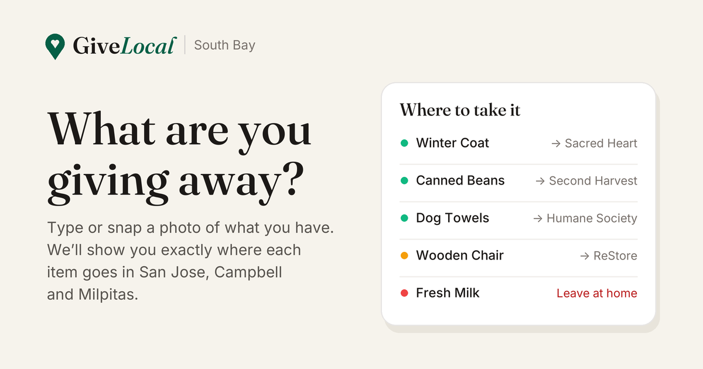

# GiveLocal South Bay

**Know exactly where your donations go.** Type, tap or photograph what you have, and GiveLocal matches every item to the San Jose, Campbell or Milpitas drop-off that actually takes it. It also flags the things pantries can't accept.

**Live site: https://givelocal-southbay-seven.vercel.app**

## The problem

Well-meaning donors bring the wrong things to the wrong places: opened food, fridge milk, a couch to a food bank. Volunteers then spend hours sorting and throwing donations away. Each organization publishes its own rules on its own website, and nobody has time to read five of them before cleaning out a closet.

## What it does

- **Type what you have.** Add items one at a time or as a list ("winter coats, dog towels, and a wooden chair"). Each one snaps into your list and sorts instantly.
- **Snap a photo** of your donation pile. Claude picks out every item it can see and sorts each one.
- **See where each item goes**, grouped into the fewest stops, with today's open hours and a Directions link for each place.
- **Leave at home:** items pantries can't take (opened or expired food, glass jars, fresh milk and meat, stained clothes, cribs...), each with a reason and a better idea.
- **Specialist drop-offs** for medicine, paint, batteries, electronics, mattresses and car seats.
- **One tap opens the whole trip in Google Maps**, starting from your current location.
- **What pantries need now:** each organization's most-needed items this week, one tap to add to your list. A staff demo shows how a coordinator could publish an urgent need.

Drop-offs covered: Sacred Heart Community Service (and its Clothes Closet), Second Harvest of Silicon Valley, Humane Society Silicon Valley, Milpitas Food Pantry, CityTeam San Jose, plus Goodwill and Habitat for Humanity ReStore for furniture, appliances and electronics.

## How it works

1. **Built-in rules first.** A rules engine of about 100 item types, plus conditions like *opened*, *expired*, *dented*, *glass*, *homemade* and *stained*, answers every item it recognizes instantly, in the browser. The same item always gets the same answer.
2. **Claude for everything else.** Unfamiliar items and photos go to Claude through a small server function. Claude returns structured JSON (item, destination, reason, what to do instead), and the built-in rules double-check every answer before it's shown.
3. **Trip planning.** Items that several places accept, like canned food, join a stop already on the trip, or go to the nearest choice. Stops are ordered nearest-first and handed to Google Maps as one multi-stop route.

The API key lives only on the server (Vercel environment variable). The page never sees it, and the server limits how often each visitor can call it.

## Tech

- `index.html`: the whole app. Vanilla JavaScript, Tailwind (CDN), Lucide icons, Fraunces and Inter fonts.
- `api/claude.js`: a Vercel serverless function that calls the Claude API with JSON-schema structured output, a time limit and a per-visitor rate limit.

## Run it yourself

1. Fork the repo and import it into [Vercel](https://vercel.com/new).
2. Add an environment variable `ANTHROPIC_API_KEY` (Project Settings → Environment Variables).
3. Deploy. The site works without the key too: typing falls back to the built-in rules, and only the photo scan needs Claude.

For a quick local look without the server function, run `python3 -m http.server` in this folder and open `http://localhost:8000`.

## A note on the data

Needs lists, hours and arrival notes are examples for this demo. Please confirm with each organization before you go.
